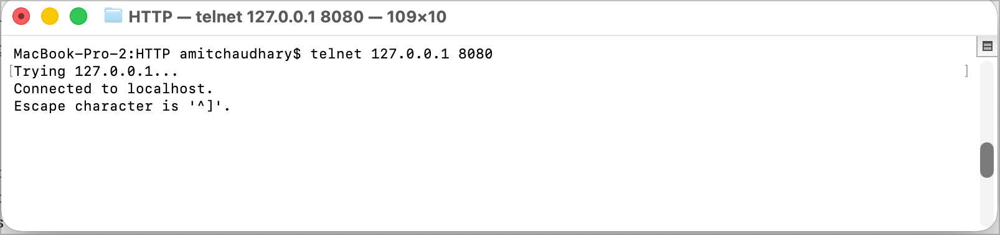
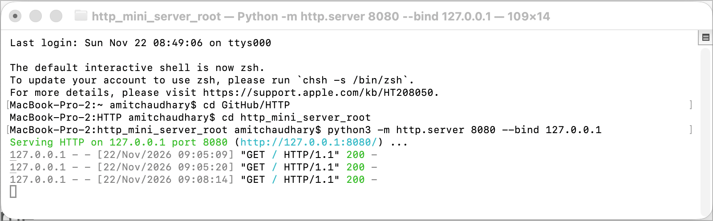
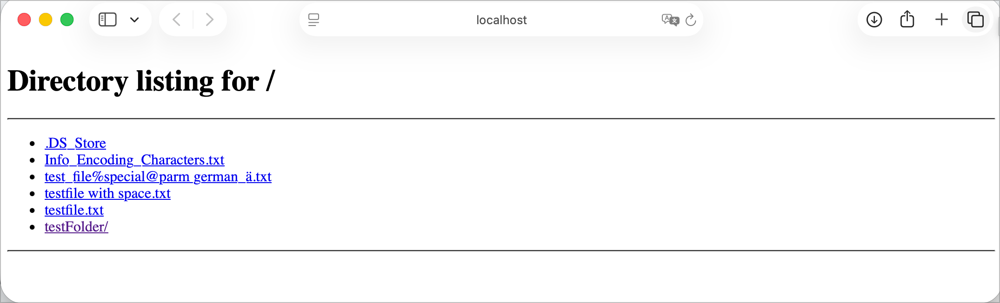
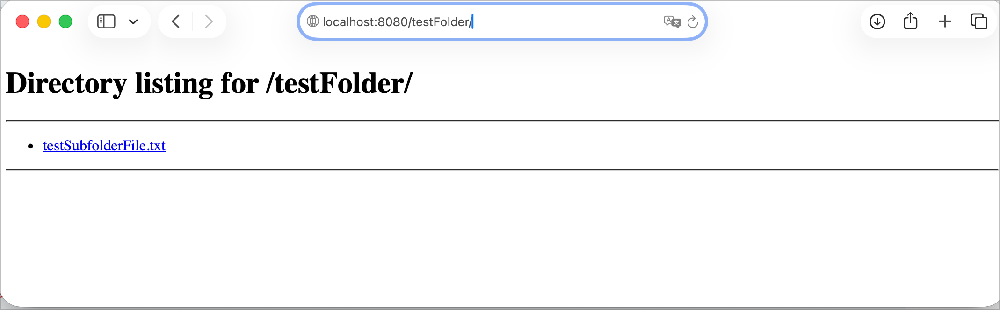

# HTTP from the ground up - learning by example

This repository teaches HTTP, the language browsers and apps use to talk to
web servers, by **typing raw requests by hand** and watching what the server
answers. No browser, no library: just text over a connection.

Each file is one small experiment. The chapters arrange them so that every
step builds on the one before. Work through them in order.

**Prerequisites**

**Required**

- **Terminal**: Terminal.app on macOS, or an equivalent terminal on Linux or Windows
- **Python 3**: to serve the local files in Chapters 2 and 3
- **Telnet**: to send raw HTTP requests in Chapters 2 through 6
- **OpenSSL**: to send raw HTTPS requests in Chapter 7

**Optional**

- **curl**: for the command-line comparisons in Chapter 8
- **R and RStudio**: for the `httr2` comparisons in Chapter 8
- **Internet access**: for the real-server experiments in Chapters 4 through 8

Check the main tools from a terminal:

```bash
python3 --version
telnet -h
openssl version
curl --version
```

**Quick Start**

Start with the local server. Open the repository in Terminal, then use two
terminal windows.

**Terminal 1 - start the server**

```bash
cd http_mini_server_root
python3 -m http.server 8080 --bind 127.0.0.1
```

**Terminal 2 - connect and send the first request**

```bash
telnet 127.0.0.1 8080
```

Paste this request, including the empty line after `Host: localhost`:

```http
GET / HTTP/1.1
Host: localhost

```

You should receive `HTTP/1.0 200 OK` and an HTML directory listing. In the
server terminal, the matching log entry should show `GET / HTTP/1.1` with
`200`.

Clone the repository, if needed, and enter it:

```bash
git clone https://github.com/amitchaudhary82/http.git
cd http
```

| Chapter | What you learn | Tool | Folder |
|---|---|---|---|
| 1 - 2 | What HTTP is, how to set up | - | - |
| 3 | Experiments on your own Mac (local server) | telnet | `telnet/` |
| 4 | Simple GET experiments on the internet | telnet | `telnet/` |
| 5 | Sending data: POST and other methods | telnet | `telnet/` |
| 6 | Adding authentication | telnet | `telnet/` |
| 7 | Bridge: the same requests, encrypted (HTTPS) | openssl | `openssl/` |
| 8 | The same examples three ways | curl, RStudio (httr2) | `curl/`, `rstudio/` |

**Experiment IDs follow the chapters:** `ECNN` = **E**xperiment + chapter +
number, e.g. `E301` is the first experiment of chapter 3, `E502` the second of
chapter 5. The `E` keeps them apart from HTTP status codes: `E404` is an
experiment, `404` is "Not Found". The same ID appears in the README, in the
request file `telnet/E301_...http`, as section `# E301` in the curl and
RStudio scripts, and in pictures: `images/E301_browser.png`.

```
HTTP/
  README.md                                   this guide
  000_Syntax_NNN_method_scenario_status.txt   file naming rule
  build_readme.sh                             refreshes snippets, numbers and contents
  telnet/          raw requests + start commands         (chapters 3 - 6)
  openssl/         raw HTTPS requests + connect commands  (chapter 7)
  curl/            curl_examples.sh                      (chapter 8)
  rstudio/         httr2_examples.R, send_http_file.R    (chapter 8)
  images/          screenshots, named after the experiment (E301_browser.png)
  http_mini_server_root/   files served by the local server
```

---

<!-- toc -->
**Contents**

- [Chapter 1: The big idea in 60 seconds](#chapter-1-the-big-idea-in-60-seconds)
  - [1.1 Status codes: the server's short answer](#11-status-codes-the-servers-short-answer)
- [Chapter 2: Setup](#chapter-2-setup)
  - [2.1 The servers we talk to](#21-the-servers-we-talk-to)
  - [2.2 Start the local server](#22-start-the-local-server)
  - [2.3 Connect with Telnet to your local server](#23-connect-with-telnet-to-your-local-server)
- [Chapter 3: The Experiments, Local Telnet](#chapter-3-the-experiments-local-telnet)
  - [3.1 The first request](#31-the-first-request)
  - [3.2 Paths: asking for different things](#32-paths-asking-for-different-things)
  - [3.3 Methods: what you want to do](#33-methods-what-you-want-to-do)
  - [3.4 Files, folders and the response](#34-files-folders-and-the-response)
  - [3.5 Special characters and URL encoding](#35-special-characters-and-url-encoding)
  - [3.6 A rule the local server ignores](#36-a-rule-the-local-server-ignores)
- [Chapter 4: The Simple GET Experiments, Internet](#chapter-4-the-simple-get-experiments-internet)
  - [4.1 Real servers on the internet](#41-real-servers-on-the-internet)
  - [4.2 Query strings: asking with options](#42-query-strings-asking-with-options)
  - [4.3 Headers: telling the server more](#43-headers-telling-the-server-more)
  - [4.4 More status codes](#44-more-status-codes)
  - [4.5 Keeping the line open](#45-keeping-the-line-open)
- [Chapter 5: The Simple POST Experiments, Internet](#chapter-5-the-simple-post-experiments-internet)
  - [5.1 Sending data (POST)](#51-sending-data-post)
  - [5.2 What if Content-Length is wrong?](#52-what-if-content-length-is-wrong)
  - [5.3 The other methods](#53-the-other-methods)
- [Chapter 6: Adding Authentication](#chapter-6-adding-authentication)
  - [6.1 Logging in with a token](#61-logging-in-with-a-token)
- [Chapter 7: Bridge: from HTTP to HTTPS](#chapter-7-bridge-from-http-to-https)
  - [7.1 The idea, in plain words](#71-the-idea-in-plain-words)
  - [7.2 The tool: openssl](#72-the-tool-openssl)
  - [7.3 Warm-up: an old friend, encrypted](#73-warm-up-an-old-friend-encrypted)
  - [7.4 E701_get_httpbin_https_200_openssl](#74-e701_get_httpbin_https_200_openssl)
  - [7.5 E702_get_githubApi_zen_200_openssl](#75-e702_get_githubapi_zen_200_openssl)
  - [7.6 What you now know](#76-what-you-now-know)
- [Chapter 8: The same examples three ways: telnet, curl, RStudio](#chapter-8-the-same-examples-three-ways-telnet-curl-rstudio)
  - [8.1 Easy start: one example, three ways](#81-easy-start-one-example-three-ways)
  - [8.2 Bonus: telnet inside RStudio](#82-bonus-telnet-inside-rstudio)
  - [8.3 All examples side by side](#83-all-examples-side-by-side)
- [Chapter 9: What you can do now](#chapter-9-what-you-can-do-now)
- [Chapter 10: Other files](#chapter-10-other-files)
  - [10.1 Maintaining this README](#101-maintaining-this-readme)
<!-- /toc -->

<br>
<br>
<br>


## Chapter 1: The big idea in 60 seconds

> Chapter navigation: [Next: Chapter 2](#chapter-2-setup)

When you open a web page, your computer sends the server a short **text
message** (the *request*) and the server sends a text message back (the
*response*). That's HTTP.

A request looks like this:

```
GET /testfile.txt HTTP/1.1      <- request line: METHOD  PATH  VERSION
Host: localhost                 <- headers: extra information, one per line
                                <- empty line: "my headers are finished"
(optional body)                 <- data you send, only for e.g. POST
```

A response looks like this:

```
HTTP/1.0 200 OK                 <- status line: VERSION  CODE  TEXT
Content-Type: text/plain        <- headers about the answer
Content-Length: 12
                                <- empty line
Hello there!                    <- body: the actual content
```

The rest of this repo is about learning each of those parts by changing one
thing at a time.

### 1.1 Status codes: the server's short answer

| Family | Meaning | Examples in this repo |
|---|---|---|
| 2xx | Success | 200 OK, 201 Created, 204 No Content |
| 3xx | Go somewhere else | 301 Moved Permanently, 302 Found |
| 4xx | **Your** request has a problem | 400 Bad Request, 401 Unauthorized, 404 Not Found, 405 Method Not Allowed |
| 5xx | The **server** can't do it | 500 Internal Server Error, 501 Not Implemented |

---

<br>
<br>
<br>


## Chapter 2: Setup

> Chapter navigation: [Previous: Chapter 1](#chapter-1-the-big-idea-in-60-seconds)
> · [Next: Chapter 3](#chapter-3-the-experiments-local-telnet)

**Setup checklist**

- [ ] Python 3 is installed and available as `python3`
- [ ] Telnet is installed
- [ ] This repository is the current working directory
- [ ] Port `8080` is available
- [ ] The server terminal remains open while you complete Chapters 2 and 3

### 2.1 The servers we talk to

| Server | What | File suffix | Folder |
|---|---|---|---|
| Local mini server | Python's built-in web server, on your own Mac | `_telnet_local` | `telnet/` |
| httpbin.org / example.org | Real test servers on the internet, plain HTTP | `_telnet_internet` | `telnet/` |
| httpbin.org / api.github.com | The same, encrypted (HTTPS) - chapter 7 | `_openssl` | `openssl/` |

The suffix names the **tool and the server**, so a file still tells you how
to send it even when it's copied somewhere else.

**httpbin.org** is a test server made for learning: it replies with a
description of the request it received, so you can see exactly what you sent.

> **Internet note:** Chapters 4 through 8 contain experiments against live
> public servers. Internet access is required, and a remote service may
> temporarily change its response or become unavailable.

### 2.2 Start the local server

Open a Terminal, go into the server folder and start it

```bash
cd http_mini_server_root
python3 -m http.server 8080 --bind 127.0.0.1
```

The Terminal will act as a server and will be waiting for incoming requests


Additional Info:
- `8080` is the **port**: like a door number on your computer
- `127.0.0.1` means "this computer only", so nobody else can connect
- leave this Terminal open; it shows every request it receives


### 2.3 Connect with Telnet to your local server

Open a **second** Terminal and connect to the server

```bash
telnet 127.0.0.1 8080       # local server    (files ending _telnet_local)

```




At this point you are connected to the server. Paste the request for the
experiment you are working through; the server's response will appear below
it.
<br>
<br>
<br>

All requests are stored as files in `telnet/` and `openssl/`.

Then paste the request shown with each experiment. The response appears below.

Tips:
- The **empty line at the end is part of the request**. Without it the server
  keeps waiting for more headers.
- The local server answers once and closes the connection. Connect again for
  the next file.
- To quit a hanging telnet: press `Ctrl + ]`, then type `quit`.
- The files contain **only** the request: no comments, so copy-paste is
  always safe. All explanations live in this README.


<br>
<br>
<br>


## Chapter 3: The Experiments, Local Telnet

> Chapter navigation: [Previous: Chapter 2](#chapter-2-setup)
> · [Next: Chapter 4](#chapter-4-the-simple-get-experiments-internet)

For this experiment we have setup folder and files with simple and special characters and we will try few combinations which will return the file names back


<br>
<br>
<br>

### 3.1 The first request

#### E301_get_root_200_telnet_local

<!-- include: telnet/E301_get_root_200_telnet_local.http -->
**Connect**

```bash
telnet 127.0.0.1 8080
```

<br>

**Request**

```bash
GET / HTTP/1.1
Host: localhost
```
<!-- /include -->

which should look like below


<br>

**Server Connection Confirmed**
```bash
MacBook-Pro-2:http_mini_server_root amitchaudhary$ python3 -m http.server 8080 --bind 127.0.0.1
Serving HTTP on 127.0.0.1 port 8080 (http://127.0.0.1:8080/) ...
127.0.0.1 - - [21/Nov/2026 22:39:55] "GET / HTTP/1.1" 200 -
```




<br>

**Response**

```bash
MacBook-Pro-2:HTTP amitchaudhary$ telnet 127.0.0.1 8080
Trying 127.0.0.1...
Connected to localhost.
Escape character is '^]'.
GET / HTTP/1.1
Host: localhost

HTTP/1.0 200 OK
Server: SimpleHTTP Python/3.15.2
Date: Sat, 21 Nov 2026 21:18:56 GMT
Content-type: text/html; charset=utf-8
Content-Length: 617

<!DOCTYPE HTML>
<html lang="en">
<head>
<meta charset="utf-8">
<style type="text/css">
:root {
color-scheme: light dark;
}
</style>
<title>Directory listing for /</title>
</head>
<body>
<h1>Directory listing for /</h1>
<hr>
<ul>
<li><a href="Info_Encoding_Characters.txt">Info_Encoding_Characters.txt</a></li>
<li><a href="test_file%25special%40parm%20german_a%CC%88.txt">test_file%special@parm german_ä.txt</a></li>
<li><a href="testfile%20with%20space.txt">testfile with space.txt</a></li>
<li><a href="testfile.txt">testfile.txt</a></li>
<li><a href="testFolder/">testFolder/</a></li>
</ul>
<hr>
</body>
</html>
Connection closed by foreign host.
```

- **Objective:** send the smallest valid request and get an answer.
- **New concepts:** request line (`GET / HTTP/1.1`), the `Host` header
  (required in HTTP/1.1, it names the server you mean), the empty line.
- **What happens:** `200 OK` and an HTML page listing the files in
  `http_mini_server_root`. `/` means "the root", the top folder of the server.
- **Notice:** the server answers `HTTP/1.0` even though you asked in 1.1. The
  Python mini server only speaks 1.0, and that's allowed.
- **Read the response:** `Content-Length: 617` = size of the HTML body in
  bytes. `Connection closed by foreign host` = the server hung up after
  answering (HTTP/1.0 does that every time).

<br>
<br>

**Simulation via Browser**

This can also be simulated in browser via using
```bash
http://localhost:8080
```



<br>
<br>
<br>

### 3.2 Paths: asking for different things

#### E302_get_foldernoSlash_301_telnet_local

<!-- include: telnet/E302_get_foldernoSlash_301_telnet_local.http -->
**Connect**

```bash
telnet 127.0.0.1 8080
```

<br>

**Request**

```bash
GET /testFolder HTTP/1.1
Host: localhost
```
<!-- /include -->

<br>

**Server Connection Confirmed**
```bash
MacBook-Pro-2:http_mini_server_root amitchaudhary$ python3 -m http.server 8080 --bind 127.0.0.1
Serving HTTP on 127.0.0.1 port 8080 (http://127.0.0.1:8080/) ...
127.0.0.1 - - [21/Nov/2026 22:39:55] "GET / HTTP/1.1" 200 -
127.0.0.1 - - [21/Nov/2026 22:44:27] "GET /testFolder HTTP/1.1" 301 -
```

<br>

**Response**

```bash
MacBook-Pro-2:HTTP amitchaudhary$ telnet 127.0.0.1 8080
Trying 127.0.0.1...
Connected to localhost.
Escape character is '^]'.
GET /testFolder HTTP/1.1
Host: localhost

HTTP/1.0 301 Moved Permanently
Server: SimpleHTTP Python/3.15.2
Date: Sat, 21 Nov 2026 21:20:00 GMT
Location: /testFolder/
Content-Length: 0

Connection closed by foreign host.
```

- **Objective:** ask for a folder **without** the trailing slash: `/testFolder`.
- **What happens:** `301 Moved Permanently` with a header
  `Location: /testFolder/`. The server says "the right address has a slash,
  ask there instead". A browser follows this automatically; telnet doesn't.
- **New concept:** redirects (3xx) and the `Location` header.
- **Read the response:** `Content-Length: 0` - no body at all, the
  `Location` header is the whole message.

<br>
<br>
<br>

#### E303_get_folder_slash_200_telnet_local

<!-- include: telnet/E303_get_folder_slash_200_telnet_local.http -->
**Connect**

```bash
telnet 127.0.0.1 8080
```

<br>

**Request**

```bash
GET /testFolder/ HTTP/1.1
Host: localhost
```
<!-- /include -->

<br>

**Response**

```bash
MacBook-Pro-2:HTTP amitchaudhary$ telnet 127.0.0.1 8080
Trying 127.0.0.1...
Connected to localhost.
Escape character is '^]'.
GET /testFolder/ HTTP/1.1
Host: localhost

HTTP/1.0 200 OK
Server: SimpleHTTP Python/3.15.2
Date: Sat, 21 Nov 2026 21:20:40 GMT
Content-type: text/html; charset=utf-8
Content-Length: 345

<!DOCTYPE HTML>
<html lang="en">
<head>
<meta charset="utf-8">
<style type="text/css">
:root {
color-scheme: light dark;
}
</style>
<title>Directory listing for /testFolder/</title>
</head>
<body>
<h1>Directory listing for /testFolder/</h1>
<hr>
<ul>
<li><a href="testSubfolderFile.txt">testSubfolderFile.txt</a></li>
</ul>
<hr>
</body>
</html>
Connection closed by foreign host.
```

- **Objective:** follow the redirect by hand: ask for `/testFolder/`.
- **What happens:** `200 OK` and a listing of the folder's content.
- **Lesson:** for a folder, `/testFolder` and `/testFolder/` are different
  requests.


This can also be simulated in browser via using
```bash
localhost:8080/testFolder/
```




<br>
<br>
<br>

#### E304_get_missingFile_404_telnet_local

<!-- include: telnet/E304_get_missingFile_404_telnet_local.http -->
**Connect**

```bash
telnet 127.0.0.1 8080
```

<br>

**Request**

```bash
GET /missingFile.txt HTTP/1.1
Host: localhost
```
<!-- /include -->

<br>

**Response**

```bash
MacBook-Pro-2:HTTP amitchaudhary$ telnet 127.0.0.1 8080
Trying 127.0.0.1...
Connected to localhost.
Escape character is '^]'.
GET /missingFile.txt HTTP/1.1
Host: localhost        

HTTP/1.0 404 File not found
Server: SimpleHTTP Python/3.15.2
Date: Sat, 21 Nov 2026 21:21:33 GMT
Connection: close
Content-Type: text/html;charset=utf-8
Content-Length: 460

<!DOCTYPE HTML>
<html lang="en">
    <head>
        <meta charset="utf-8">
        <style type="text/css">
            :root {
                color-scheme: light dark;
            }
        </style>
        <title>Error response</title>
    </head>
    <body>
        <h1>Error response</h1>
        <p>Error code: 404</p>
        <p>Message: File not found.</p>
        <p>Error code explanation: 404 - Nothing matches the given URI.</p>
    </body>
</html>
Connection closed by foreign host.
```

- **Objective:** ask for a file that does not exist.
- **What happens:** `404 File not found`. The connection worked, the request
  was valid, there is just nothing at that path.
- **Lesson:** 4xx means "your request asked for something wrong", not "the
  server is broken".
- **Read the response:** even an error has a body - an HTML error page
  (`Content-Length: 460`).

<br>
<br>
<br>

### 3.3 Methods: what you want to do

#### E305_head_root_200_telnet_local

<!-- include: telnet/E305_head_root_200_telnet_local.http -->
**Connect**

```bash
telnet 127.0.0.1 8080
```

<br>

**Request**

```bash
HEAD / HTTP/1.1
Host: localhost
```
<!-- /include -->

<br>

**Response**

```bash
(paste the response from telnet here)
```

- **Objective:** use the `HEAD` method instead of `GET`.
- **What happens:** `200 OK` with the same headers as E301, but **no body**.
- **Lesson:** the method says *what to do*. `HEAD` = "only tell me about it"
  (size, type, date), useful to check something without downloading it.

<br>
<br>
<br>

#### E306_get_badMethod_501_telnet_local

<!-- include: telnet/E306_get_badMethod_501_telnet_local.http -->
**Connect**

```bash
telnet 127.0.0.1 8080
```

<br>

**Request**

```bash
BADMETHOD / HTTP/1.1
Host: localhost
```
<!-- /include -->

<br>

**Response**

```bash
(paste the response from telnet here)
```

- **Objective:** invent a method the server doesn't know: `BADMETHOD`.
- **What happens:** `501 Unsupported method ('BADMETHOD')`.
- **Lesson:** a method is just a word; the server decides which ones it
  supports. 5xx because the *server* can't do it (it isn't "your path is
  wrong" like 404).

<br>
<br>

**All request methods at a glance**

The method is the first word of the request line. It tells the server
**what you want to do**. These are the ones you will meet most:

| Method | In plain words | Used for | Has a body? | Tried in |
|---|---|---|---|---|
| GET | "Give me information" | Read data only. Should NOT change anything. The most common method. | No | most files |
| HEAD | "Give me info, but no body" | Like GET, but returns only status + headers. Check if something exists, its type, its date. Mostly used by systems. | No | E305, E310 |
| POST | "I am sending you data" | Create something / send data to process. Usually changes something on the server. | Yes (often JSON) | E501 - E506 |
| PUT | "Replace it with this" | Replace a WHOLE resource: delete the old version, store the new one. | Yes | E507 |
| PATCH | "Change only this part" | Update PART of a resource. | Yes | E508 |
| DELETE | "Remove it" | Delete a resource. | Usually no | E509 |
| OPTIONS | "What are my choices?" | Ask which methods are allowed at this path. | No | E510 |

**PUT vs PATCH** - think of a profile with name and city:
- PUT `{"name":"Amit","city":"Zurich"}` = "this is the complete new profile"
- PATCH `{"city":"Bern"}` = "only change the city, keep the rest"

In practice teams sometimes use these loosely - don't worry too much.

**Safe to repeat? (the word is *idempotent*)**
Doing GET, HEAD, PUT or DELETE twice gives the same result as doing it once.
POST is different: sending it twice usually creates two things (two orders,
two comments). That's the real difference between POST and PUT.

<br>
<br>
<br>

### 3.4 Files, folders and the response

#### E307_get_file_200_telnet_local

<!-- include: telnet/E307_get_file_200_telnet_local.http -->
**Connect**

```bash
telnet 127.0.0.1 8080
```

<br>

**Request**

```bash
GET /testfile.txt HTTP/1.1
Host: localhost
```
<!-- /include -->

<br>

**Response**

```bash
(paste the response from telnet here)
```

- **Objective:** download an actual file: `/testfile.txt`.
- **What happens:** `200 OK`, `Content-Type: text/plain`, a `Content-Length`
  header with the file size in bytes, then the file's text as the body.
- **New concepts:** `Content-Type` (what kind of data) and `Content-Length`
  (how many bytes follow). Remember `Content-Length`: it's the star of
  section 5.2.

<br>
<br>
<br>

#### E308_get_subFolderFile_200_telnet_local

<!-- include: telnet/E308_get_subFolderFile_200_telnet_local.http -->
**Connect**

```bash
telnet 127.0.0.1 8080
```

<br>

**Request**

```bash
GET /testFolder/testSubfolderFile.txt HTTP/1.1
Host: localhost
```
<!-- /include -->

<br>

**Response**

```bash
(paste the response from telnet here)
```

- **Objective:** reach a file inside a sub-folder:
  `/testFolder/testSubfolderFile.txt`.
- **What happens:** `200 OK` with the file content.
- **Lesson:** the path works like folders on disk, separated by `/`.

<br>
<br>
<br>

#### E309_get_doubleSlash_200_telnet_local

<!-- include: telnet/E309_get_doubleSlash_200_telnet_local.http -->
**Connect**

```bash
telnet 127.0.0.1 8080
```

<br>

**Request**

```bash
GET // HTTP/1.1
Host: localhost
```
<!-- /include -->

<br>

**Response**

```bash
(paste the response from telnet here)
```

- **Objective:** see how the server handles a strange path: `//`.
- **What happens:** `200 OK`, the root listing again: the server tidies the
  path up.
- **Lesson:** servers *normalise* paths. Not every server does it the same
  way, which is why odd paths are a classic thing to test.

<br>
<br>
<br>

#### E310_head_file_headers_200_telnet_local

<!-- include: telnet/E310_head_file_headers_200_telnet_local.http -->
**Connect**

```bash
telnet 127.0.0.1 8080
```

<br>

**Request**

```bash
HEAD /testfile.txt HTTP/1.1
Host: localhost

```
<!-- /include -->

<br>

**Response**

```bash
(paste the response from telnet here)
```

- **Objective:** study the response headers on their own, without a body in
  the way.
- **What happens:** `200 OK` and only headers. Read each one:

  | Header | Tells you |
  |---|---|
  | `Server` | which software answered (here: SimpleHTTP / Python) |
  | `Date` | when the server answered |
  | `Content-type` | what kind of file it is |
  | `Content-Length` | its size in bytes |
  | `Last-Modified` | when the file last changed |

- **Lesson:** compare with E307 - identical headers, only the body is
  missing. This is how programs check "has this file changed?" cheaply.

<br>
<br>
<br>

### 3.5 Special characters and URL encoding

The test folder contains files with awkward names on purpose:
`testfile with space.txt` and `test_file%special@parm german_ä.txt`.
Background notes: `http_mini_server_root/Info_Encoding_Characters.txt`.

<br>
<br>
<br>

#### E311_get_fileNameSpaces_400_telnet_local

<!-- include: telnet/E311_get_fileNameSpaces_400_telnet_local.http -->
**Connect**

```bash
telnet 127.0.0.1 8080
```

<br>

**Request**

```bash
GET /testfile with space.txt HTTP/1.1
Host: localhost
```
<!-- /include -->

<br>

**Response**

```bash
(paste the response from telnet here)
```

- **Objective:** ask for a file whose name contains spaces, typed as-is.
- **What happens:** `400 Bad Request`. The request line must be exactly
  *three* parts separated by spaces (method, path, version). The spaces in
  the name split it into five parts, and the server can't read it.
- **Lesson:** some characters can't appear raw in a path.

<br>
<br>
<br>

#### E312_get_fileNameQuotes_400_telnet_local

<!-- include: telnet/E312_get_fileNameQuotes_400_telnet_local.http -->
**Connect**

```bash
telnet 127.0.0.1 8080
```

<br>

**Request**

```bash
GET /"testfile with space.txt" HTTP/1.1
Host: localhost
```
<!-- /include -->

<br>

**Response**

```bash
(paste the response from telnet here)
```

- **Objective:** try to "protect" the spaces with quotes.
- **What happens:** still `400 Bad Request`.
- **Lesson:** quotes mean nothing in HTTP; they are just more characters.
  There's a proper mechanism instead (next file).

<br>
<br>
<br>

#### E313_get_fileNameUrlEncoding_200_telnet_local

<!-- include: telnet/E313_get_fileNameUrlEncoding_200_telnet_local.http -->
**Connect**

```bash
telnet 127.0.0.1 8080
```

<br>

**Request**

```bash
GET /testfile%20with%20space.txt HTTP/1.1
Host: localhost
```
<!-- /include -->

<br>

**Response**

```bash
(paste the response from telnet here)
```

- **Objective:** write each space as `%20`.
- **What happens:** `200 OK`, the file is found.
- **New concept: URL encoding (percent-encoding).** A forbidden character is
  replaced by `%` plus its code in hexadecimal. Space is code 32 = hex 20, so
  space becomes `%20`. The server decodes it back.

<br>
<br>
<br>

#### E314_get_fileNameSpecialCharUrlEncoding_200_telnet_local

<!-- include: telnet/E314_get_fileNameSpecialCharUrlEncoding_200_telnet_local.http -->
**Connect**

```bash
telnet 127.0.0.1 8080
```

<br>

**Request**

```bash
GET /test_file%25special%40parm%20german_%C3%A4.txt HTTP/1.1
Host: localhost
```
<!-- /include -->

<br>

**Response**

```bash
(paste the response from telnet here)
```

- **Objective:** encode several special characters at once.
- **What happens:** `200 OK` for the file `test_file%special@parm german_ä.txt`.
- **Decoding table:**

  | Encoded | Character | Why it needs encoding |
  |---|---|---|
  | `%25` | `%` | `%` itself starts an encoding, so it must be encoded too |
  | `%40` | `@` | `@` has a special meaning in URLs (user@host) |
  | `%20` | space | splits the request line (see E311) |
  | `%C3%A4` | `ä` | non-English letters are sent as UTF-8 bytes: `ä` is **two** bytes, C3 and A4 |

- **Lesson:** libraries (browsers, curl, R's httr2) do this encoding for
  you. Here you did it by hand, so you know what's happening underneath.
- **Notice:** in the E301 listing this file's link is `german_a%CC%88`:
  macOS stores `ä` as `a` + `¨` (two characters). Both forms find the file.

<br>
<br>
<br>

### 3.6 A rule the local server ignores

#### E315_get_root_missingHost_200_telnet_local

<!-- include: telnet/E315_get_root_missingHost_200_telnet_local.http -->
**Connect**

```bash
telnet 127.0.0.1 8080
```

<br>

**Request**

```bash
GET / HTTP/1.1

```
<!-- /include -->

<br>

**Response**

```bash
(paste the response from telnet here)
```

- **Objective:** leave out the `Host` header on the local mini server.
- **What happens:** `200 OK` - it answers anyway.
- **Lesson:** not every server enforces every rule. A request that "works"
  on one server can fail on another, so test against the real target.
  Compare with E404 in chapter 4: the same request on a real server.

<br>
<br>
<br>

## Chapter 4: The Simple GET Experiments, Internet

> Chapter navigation: [Previous: Chapter 3](#chapter-3-the-experiments-local-telnet)
> · [Next: Chapter 5](#chapter-5-the-simple-post-experiments-internet)

These experiments require internet access and plain HTTP. Live server
responses can change; use the expected status code and response structure
from each experiment as a success check, not exact wording or formatting.

All experiments in this chapter go to real servers on the internet:
`telnet httpbin.org 80` (or `telnet example.org 80` for E403).

<br>
<br>
<br>

### 4.1 Real servers on the internet

#### E401_get_httpbin_get_200_telnet_internet

<!-- include: telnet/E401_get_httpbin_get_200_telnet_internet.http -->
**Connect**

```bash
telnet httpbin.org 80
```

<br>

**Request**

```bash
GET / HTTP/1.1
Host: httpbin.org
Connection: close
```
<!-- /include -->

<br>

**Response**

```bash
(paste the response from telnet here)
```

- **Objective:** the same kind of request as E301, but to a real server.
- **New header:** `Connection: close`, asking the server to hang up after
  answering. Without it, HTTP/1.1 keeps the connection open for more
  requests, and telnet just sits there.
- **What happens:** `HTTP/1.1 200 OK` and httpbin's HTML home page.
- **Notice:** this server answers in HTTP/1.1, and sends more headers than
  the mini server (date, server type, security headers ...).

<br>
<br>
<br>

#### E402_get_httpbin_ip_200_telnet_internet

<!-- include: telnet/E402_get_httpbin_ip_200_telnet_internet.http -->
**Connect**

```bash
telnet httpbin.org 80
```

<br>

**Request**

```bash
GET /ip HTTP/1.1
Host: httpbin.org
Connection: close

```
<!-- /include -->

<br>

**Response**

```bash
(paste the response from telnet here)
```

- **Objective:** ask for `/ip`, an *API endpoint* rather than a web page.
- **What happens:** `200 OK` with `Content-Type: application/json` and a
  body like `{"origin": "<your public IP address>"}`.
- **New concept:** JSON, the data format most APIs answer in: made for
  programs, not people.

<br>
<br>
<br>

#### E403_get_example_200_telnet_internet

<!-- include: telnet/E403_get_example_200_telnet_internet.http -->
**Connect**

```bash
telnet example.org 80
```

<br>

**Request**

```bash
GET / HTTP/1.1
Host: example.org
Connection: close

```
<!-- /include -->

<br>

**Response**

```bash
(paste the response from telnet here)
```

- **Objective:** a different public server: `example.org`.
- **What happens:** `200 OK` with a small HTML page ("Example Domain").
- **Lesson:** the `Host` header must match the server you connected to.
  HTTP works the same everywhere.

<br>
<br>
<br>

#### E404_get_httpbin_missingHost_400_telnet_internet

<!-- include: telnet/E404_get_httpbin_missingHost_400_telnet_internet.http -->
**Connect**

```bash
telnet httpbin.org 80
```

<br>

**Request**

```bash
GET /get HTTP/1.1
Connection: close

```
<!-- /include -->

<br>

**Response**

```bash
(paste the response from telnet here)
```

- **Objective:** leave out the `Host` header on a real server.
- **What happens:** `400 Bad Request`.
- **Lesson:** in HTTP/1.1, `Host` is **required**. One machine can host many
  websites, and `Host` says which one you mean. (The local server in E315
  didn't care - real servers do.)

<br>
<br>
<br>

### 4.2 Query strings: asking with options

The path says **what** you want. The **query**, everything after `?`, says
**how** you want it: `key=value` pairs joined by `&`. These go to httpbin
(`telnet httpbin.org 80`), whose `/get` replies with the pairs it understood
under `"args"`.

<br>
<br>
<br>

#### E405_get_httpbin_queryString_200_telnet_internet

<!-- include: telnet/E405_get_httpbin_queryString_200_telnet_internet.http -->
**Connect**

```bash
telnet httpbin.org 80
```

<br>

**Request**

```bash
GET /get?name=Amit&city=Zurich HTTP/1.1
Host: httpbin.org
Connection: close

```
<!-- /include -->

<br>

**Response**

```bash
MacBook-Pro-2:HTTP amitchaudhary$ telnet httpbin.org 80
Trying 54.172.45.38...
Connected to httpbin.org.
Escape character is '^]'.
GET /get?name=Amit&city=Zurich HTTP/1.1
Host: httpbin.org
Connection: close

HTTP/1.1 200 OK
access-control-allow-credentials: true
access-control-allow-origin: *
access-control-expose-headers: Retry-After, RateLimit, RateLimit-Policy, WWW-Authenticate
content-length: 211
content-type: application/json
x-content-type-options: nosniff
date: Sat, 21 Nov 2026 21:22:39 GMT
connection: close

{
  "args": {
    "city": "Zurich",
    "name": "Amit"
  },
  "headers": {
    "Host": "httpbin.org"
  },
  "method": "GET",
  "origin": "xx.xxx.xxx.x",
  "url": "http://httpbin.org/get?name=Amit&city=Zurich"
}
Connection closed by foreign host.
```

- **Objective:** send two query parameters.
- **What happens:** `200 OK`, JSON with `"args": {"city": "Zurich", "name": "Amit"}`.
- **Lesson:** `?` starts the query, `=` joins key and value, `&` separates pairs.
- **Read the response:** `"headers"` lists only `Host` - telnet sends nothing
  you didn't type. (curl and httr2 add more, see chapter 8.)

<br>
<br>
<br>

#### E406_get_httpbin_querySpaceEncoded_200_telnet_internet

<!-- include: telnet/E406_get_httpbin_querySpaceEncoded_200_telnet_internet.http -->
**Connect**

```bash
telnet httpbin.org 80
```

<br>

**Request**

```bash
GET /get?city=St%20Gallen HTTP/1.1
Host: httpbin.org
Connection: close

```
<!-- /include -->

<br>

**Response**

```bash
MacBook-Pro-2:HTTP amitchaudhary$ telnet httpbin.org 80
Trying 54.172.45.38...
Connected to httpbin.org.
Escape character is '^]'.
GET /get?city=St%20Gallen HTTP/1.1
Host: httpbin.org
Connection: close

HTTP/1.1 200 OK
access-control-allow-credentials: true
access-control-allow-origin: *
access-control-expose-headers: Retry-After, RateLimit, RateLimit-Policy, WWW-Authenticate
content-length: 189
content-type: application/json
x-content-type-options: nosniff
date: Sat, 21 Nov 2026 21:24:11 GMT
connection: close

{
  "args": {
    "city": "St Gallen"
  },
  "headers": {
    "Host": "httpbin.org"
  },
  "method": "GET",
  "origin": "xx.xxx.xxx.x",
  "url": "http://httpbin.org/get?city=St%20Gallen"
}
Connection closed by foreign host.
```

- **Objective:** a value with a space: `city=St%20Gallen`.
- **What happens:** `"args": {"city": "St Gallen"}`, while `"url"` still
  shows `St%20Gallen`: the URL travels encoded, the value arrives decoded.
- **Lesson:** the same `%20` rule as in paths (3.5) applies in the query.

<br>
<br>
<br>

#### E407_get_httpbin_queryAmpersandEncoded_200_telnet_internet

<!-- include: telnet/E407_get_httpbin_queryAmpersandEncoded_200_telnet_internet.http -->
**Connect**

```bash
telnet httpbin.org 80
```

<br>

**Request**

```bash
GET /get?company=Johnson%26Johnson&country=US HTTP/1.1
Host: httpbin.org
Connection: close

```
<!-- /include -->

<br>

**Response**

```bash
MacBook-Pro-2:HTTP amitchaudhary$ telnet httpbin.org 80
Trying 3.221.253.123...
Connected to httpbin.org.
Escape character is '^]'.
GET /get?company=Johnson%26Johnson&country=US HTTP/1.1
Host: httpbin.org
Connection: close

HTTP/1.1 200 OK
access-control-allow-credentials: true
access-control-allow-origin: *
access-control-expose-headers: Retry-After, RateLimit, RateLimit-Policy, WWW-Authenticate
content-length: 239
content-type: application/json
x-content-type-options: nosniff
date: Sat, 21 Nov 2026 21:25:44 GMT
connection: close

{
  "args": {
    "company": "Johnson&Johnson",
    "country": "US"
  },
  "headers": {
    "Host": "httpbin.org"
  },
  "method": "GET",
  "origin": "xx.xxx.xxx.x",
  "url": "http://httpbin.org/get?company=Johnson%26Johnson&country=US"
}
Connection closed by foreign host.
```

- **Objective:** a value that contains `&`: `company=Johnson%26Johnson`.
- **What happens:** two values: `"company": "Johnson&Johnson"` and
  `"country": "US"` - the encoded `%26` stayed inside the value.
- **Lesson:** a raw `&` would start a new parameter, so inside a value it must
  be encoded as `%26`. Try it unencoded and see the value split in two.

<br>
<br>
<br>

#### E408_get_httpbin_queryPlusSign_200_telnet_internet

<!-- include: telnet/E408_get_httpbin_queryPlusSign_200_telnet_internet.http -->
**Connect**

```bash
telnet httpbin.org 80
```

<br>

**Request**

```bash
GET /get?q=a+b&r=a%2Bb HTTP/1.1
Host: httpbin.org
Connection: close

```
<!-- /include -->

<br>

**Response**

```bash
MacBook-Pro-2:HTTP amitchaudhary$ telnet httpbin.org 80
Trying 3.221.253.123...
Connected to httpbin.org.
Escape character is '^]'.
GET /get?q=a+b&r=a%2Bb HTTP/1.1
Host: httpbin.org
Connection: close

HTTP/1.1 200 OK
access-control-allow-credentials: true
access-control-allow-origin: *
access-control-expose-headers: Retry-After, RateLimit, RateLimit-Policy, WWW-Authenticate
content-length: 193
content-type: application/json
x-content-type-options: nosniff
date: Sat, 21 Nov 2026 21:26:33 GMT
connection: close

{
  "args": {
    "q": "a b",
    "r": "a+b"
  },
  "headers": {
    "Host": "httpbin.org"
  },
  "method": "GET",
  "origin": "xx.xxx.xxx.x",
  "url": "http://httpbin.org/get?q=a+b&r=a%2Bb"
}
Connection closed by foreign host.
```

- **Objective:** compare `q=a+b` with `r=a%2Bb`.
- **What happens:** `"q": "a b"` but `"r": "a+b"`.
- **Lesson:** in a **query**, `+` traditionally means a space. A real plus
  sign must be sent as `%2B`. (In a *path*, `+` is just a plus.)

<br>
<br>
<br>

### 4.3 Headers: telling the server more

#### E409_get_httpbin_multipleHeaders_200_telnet_internet

<!-- include: telnet/E409_get_httpbin_multipleHeaders_200_telnet_internet.http -->
**Connect**

```bash
telnet httpbin.org 80
```

<br>

**Request**

```bash
GET /get HTTP/1.1
Host: httpbin.org
Accept: application/json
User-Agent: FileTest/1.0
Connection: close
```
<!-- /include -->

<br>

**Response**

```bash
(paste the response from telnet here)
```

- **Objective:** send several headers and see them arrive.
- **New headers:**
  - `Accept`: which format you'd like back
  - `User-Agent`: who is calling (browsers send their name here; you can
    send anything)
- **What happens:** `200 OK`. httpbin's `/get` replies with JSON listing the
  headers it received, including your `"User-Agent": "FileTest/1.0"`.
- **Lesson:** headers are how client and server exchange extra information:
  what you want, who you are, what you send.

<br>
<br>
<br>

### 4.4 More status codes

httpbin's `/status/NNN` answers with whatever code you ask for: a safe way to
see codes you rarely meet on purpose.

<br>
<br>
<br>

#### E410_get_httpbin_status201_201_telnet_internet

<!-- include: telnet/E410_get_httpbin_status201_201_telnet_internet.http -->
**Connect**

```bash
telnet httpbin.org 80
```

<br>

**Request**

```bash
GET /status/201 HTTP/1.1
Host: httpbin.org
Connection: close

```
<!-- /include -->

<br>

**Response**

```bash
(paste the response from telnet here)
```

- **What happens:** `201 CREATED`.
- **Lesson:** 201 is the typical answer to a successful POST that created
  something new (an issue, an order).

<br>
<br>
<br>

#### E411_get_httpbin_status204_204_telnet_internet

<!-- include: telnet/E411_get_httpbin_status204_204_telnet_internet.http -->
**Connect**

```bash
telnet httpbin.org 80
```

<br>

**Request**

```bash
GET /status/204 HTTP/1.1
Host: httpbin.org
Connection: close

```
<!-- /include -->

<br>

**Response**

```bash
(paste the response from telnet here)
```

- **What happens:** `204 NO CONTENT` and no body at all.
- **Lesson:** success doesn't always come with data. A DELETE often answers
  204: "done, nothing more to say".

<br>
<br>
<br>

#### E412_get_httpbin_status500_500_telnet_internet

<!-- include: telnet/E412_get_httpbin_status500_500_telnet_internet.http -->
**Connect**

```bash
telnet httpbin.org 80
```

<br>

**Request**

```bash
GET /status/500 HTTP/1.1
Host: httpbin.org
Connection: close

```
<!-- /include -->

<br>

**Response**

```bash
(paste the response from telnet here)
```

- **What happens:** `500 INTERNAL SERVER ERROR`.
- **Lesson:** the classic "the server broke" code. Your request was fine;
  retrying later may help.

<br>
<br>
<br>

#### E413_get_httpbin_redirectChain_302_telnet_internet

<!-- include: telnet/E413_get_httpbin_redirectChain_302_telnet_internet.http -->
**Connect**

```bash
telnet httpbin.org 80
```

<br>

**Request**

```bash
GET /redirect/2 HTTP/1.1
Host: httpbin.org
Connection: close

```
<!-- /include -->

<br>

**Response**

```bash
(paste the response from telnet here)
```

- **Objective:** follow a chain of redirects by hand.
- **What happens:** `302 FOUND` with a `Location` header pointing to the next
  address. Send a new request to that address: another `302`. The next one
  finally gives `200`.
- **Lesson:** 301 = moved forever, 302 = "look over there for now". Browsers
  and libraries follow these silently; here you see each hop.

<br>
<br>
<br>

### 4.5 Keeping the line open

#### E414_get_httpbin_keepAliveTwoRequests_200_telnet_internet

<!-- include: telnet/E414_get_httpbin_keepAliveTwoRequests_200_telnet_internet.http -->
**Connect**

```bash
telnet httpbin.org 80
```

<br>

**Request**

```bash
GET /get?request=1 HTTP/1.1
Host: httpbin.org

GET /get?request=2 HTTP/1.1
Host: httpbin.org
Connection: close

```
<!-- /include -->

<br>

**Response**

```bash
(paste the response from telnet here)
```

- **Objective:** send two requests over **one** connection.
- **What happens:** two complete responses, one after the other
  (`"request": "1"`, then `"request": "2"`), then the server hangs up.
- **Lesson:** this is *keep-alive*, what E502 leaves open. Opening a connection
  takes time, so reusing it makes many small requests much faster.
  `Connection: close` on the last request ends it cleanly.

<br>
<br>
<br>

## Chapter 5: The Simple POST Experiments, Internet

> Chapter navigation: [Previous: Chapter 4](#chapter-4-the-simple-get-experiments-internet)
> · [Next: Chapter 6](#chapter-6-adding-authentication)


### 5.1 Sending data (POST)

`GET` only *asks*. `POST` *sends data* to the server, in the **body** after
the empty line. httpbin's `/post` endpoint echoes back what it received.

<br>
<br>
<br>

#### E501_post_httpbinText_200_telnet_internet

<!-- include: telnet/E501_post_httpbinText_200_telnet_internet.http -->
**Connect**

```bash
telnet httpbin.org 80
```

<br>

**Request**

```bash
POST /post HTTP/1.1
Host: httpbin.org
Content-Type: text/plain
Content-Length: 11
Connection: close

hello world
```
<!-- /include -->

<br>

**Response**

```bash
(paste the response from telnet here)
```

- **Objective:** send the text `hello world`.
- **New concepts:**
  - `Content-Type: text/plain` tells the server what kind of data the body is
  - `Content-Length: 11` tells it how many bytes to read: `hello world` is
    exactly 11 characters (the space counts)
- **What happens:** `200 OK`, and the JSON reply contains
  `"data": "hello world"`: proof the server got it.

<br>
<br>
<br>

#### E502_post_httpbinJson_200_telnet_internet

<!-- include: telnet/E502_post_httpbinJson_200_telnet_internet.http -->
**Connect**

```bash
telnet httpbin.org 80
```

<br>

**Request**

```bash
POST /post HTTP/1.1
Host: httpbin.org
Content-Type: application/json
Content-Length: 36

{"name":"Amit","city":"Switzerland"}
```
<!-- /include -->

<br>

**Response**

```bash
(paste the response from telnet here)
```

- **Objective:** send JSON data: `{"name":"Amit","city":"Switzerland"}`.
- **What happens:** `200 OK`. Because `Content-Type` says
  `application/json`, httpbin also *understands* it, and shows it parsed
  under `"json": {"city": "Switzerland", "name": "Amit"}`.
- **Notice:** `Content-Length: 36` matches the JSON exactly (count it!).
- **Intentionally no `Connection: close`:** telnet stays connected after the
  answer, until the server times out or you quit. That's HTTP/1.1
  *keep-alive* - see E414 (chapter 4) for what it's good for.

<br>
<br>
<br>

### 5.2 What if Content-Length is wrong?

The server reads the body **only by counting bytes**. These files break that
count on purpose to see what happens.

<br>
<br>
<br>

#### E503_post_httpbinText_shortLength_200_telnet_internet

<!-- include: telnet/E503_post_httpbinText_shortLength_200_telnet_internet.http -->
**Connect**

```bash
telnet httpbin.org 80
```

<br>

**Request**

```bash
POST /post HTTP/1.1
Host: httpbin.org
Content-Type: text/plain
Content-Length: 8
Connection: close

hello world
```
<!-- /include -->

<br>

**Response**

```bash
(paste the response from telnet here)
```

- **Objective:** say `Content-Length: 8`, but send 11 bytes.
- **What happens:** `200 OK`, but `"data": "hello wo"`. The server read
  exactly 8 bytes and ignored the rest (`rld`).
- **Lesson:** the server trusts `Content-Length`, not what you actually sent.

<br>
<br>
<br>

#### E504_post_httpbinText_longLength_timeout_telnet_internet

<!-- include: telnet/E504_post_httpbinText_longLength_timeout_telnet_internet.http -->
**Connect**

```bash
telnet httpbin.org 80
```

<br>

**Request**

```bash
POST /post HTTP/1.1
Host: httpbin.org
Content-Type: text/plain
Content-Length: 25
Connection: close

hello world
```
<!-- /include -->

<br>

**Response**

```bash
(paste the response from telnet here)
```

- **Objective:** say `Content-Length: 25`, but send only 11 bytes.
- **What happens:** **nothing, for a while.** The server waits for the 14
  missing bytes. After a timeout it gives up or closes the connection.
- **Lesson:** a too-large length makes the server hang. A classic cause of
  "my request is stuck".

<br>
<br>
<br>

#### E505_post_httpbinText_missingLengthNoData_telnet_internet

<!-- include: telnet/E505_post_httpbinText_missingLengthNoData_telnet_internet.http -->
**Connect**

```bash
telnet httpbin.org 80
```

<br>

**Request**

```bash
POST /post HTTP/1.1
Host: httpbin.org
Content-Type: text/plain
Connection: close

hello world
```
<!-- /include -->

<br>

**Response**

```bash
(paste the response from telnet here)
```

- **Objective:** leave `Content-Length` out completely.
- **What happens:** the server assumes the body is **empty**: the reply shows
  `"data": ""`. Your `hello world` is not treated as body (and may even be
  read as the start of a new, invalid request).
- **Lesson:** with a body, `Content-Length` is effectively required (or
  another way of marking the end, which libraries handle for you).

<br>
<br>
<br>

#### E506_post_httpbinText_missingBlankLine_400_telnet_internet

<!-- include: telnet/E506_post_httpbinText_missingBlankLine_400_telnet_internet.http -->
**Connect**

```bash
telnet httpbin.org 80
```

<br>

**Request**

```bash
POST /post HTTP/1.1
Host: httpbin.org
Content-Type: text/plain
Connection: close
Content-Length: 11
hello world
```
<!-- /include -->

<br>

**Response**

```bash
(paste the response from telnet here)
```

- **Objective:** forget the empty line between headers and body.
- **What happens:** `400 Bad Request`. Without the empty line the server
  thinks `hello world` is another header, and a header must look like
  `Name: value`.
- **Lesson:** the empty line is the only thing that separates headers from
  the body. It's small but essential.

<br>
<br>
<br>

### 5.3 The other methods

httpbin has an endpoint for each method (`/put`, `/patch`, `/delete`) that
echoes back what it received. Same idea as 5.1, new methods.

<br>
<br>
<br>

#### E507_put_httpbinJson_200_telnet_internet

<!-- include: telnet/E507_put_httpbinJson_200_telnet_internet.http -->
**Connect**

```bash
telnet httpbin.org 80
```

<br>

**Request**

```bash
PUT /put HTTP/1.1
Host: httpbin.org
Content-Type: application/json
Content-Length: 31
Connection: close

{"name":"Amit","city":"Zurich"}
```
<!-- /include -->

<br>

**Response**

```bash
(paste the response from telnet here)
```

- **Objective:** replace a whole resource with PUT: `{"name":"Amit","city":"Zurich"}`.
- **What happens:** `200 OK`, the reply shows your data under `"json"`.
- **Notice:** the request looks exactly like a POST - only the method word
  differs. The *meaning* (replace the whole thing) is a promise between
  client and server, not something the text enforces.

<br>
<br>
<br>

#### E508_patch_httpbinJson_200_telnet_internet

<!-- include: telnet/E508_patch_httpbinJson_200_telnet_internet.http -->
**Connect**

```bash
telnet httpbin.org 80
```

<br>

**Request**

```bash
PATCH /patch HTTP/1.1
Host: httpbin.org
Content-Type: application/json
Content-Length: 15
Connection: close

{"city":"Bern"}
```
<!-- /include -->

<br>

**Response**

```bash
(paste the response from telnet here)
```

- **Objective:** change only one field with PATCH: `{"city":"Bern"}`.
- **What happens:** `200 OK`, the reply echoes `"city": "Bern"`.
- **Lesson:** PATCH sends only the part that changes, PUT sends everything.

<br>
<br>
<br>

#### E509_delete_httpbin_200_telnet_internet

<!-- include: telnet/E509_delete_httpbin_200_telnet_internet.http -->
**Connect**

```bash
telnet httpbin.org 80
```

<br>

**Request**

```bash
DELETE /delete HTTP/1.1
Host: httpbin.org
Connection: close

```
<!-- /include -->

<br>

**Response**

```bash
(paste the response from telnet here)
```

- **Objective:** send a DELETE request.
- **What happens:** `200 OK` with a JSON echo. (httpbin has nothing to
  really delete - on a real API this would remove the resource.)
- **Notice:** no body and no `Content-Length` needed: the path says what to
  delete.

<br>
<br>
<br>

#### E510_options_httpbin_200_telnet_internet

<!-- include: telnet/E510_options_httpbin_200_telnet_internet.http -->
**Connect**

```bash
telnet httpbin.org 80
```

<br>

**Request**

```bash
OPTIONS /get HTTP/1.1
Host: httpbin.org
Connection: close

```
<!-- /include -->

<br>

**Response**

```bash
(paste the response from telnet here)
```

- **Objective:** ask the server which methods it accepts at `/get`.
- **What happens:** `200 OK` with an `Allow` header, e.g.
  `Allow: GET, HEAD, OPTIONS`, and no real body.
- **Lesson:** you can ask a server about its rules before using it.

<br>
<br>
<br>

#### E511_get_httpbin_wrongMethod_405_telnet_internet

<!-- include: telnet/E511_get_httpbin_wrongMethod_405_telnet_internet.http -->
**Connect**

```bash
telnet httpbin.org 80
```

<br>

**Request**

```bash
GET /post HTTP/1.1
Host: httpbin.org
Connection: close

```
<!-- /include -->

<br>

**Response**

```bash
(paste the response from telnet here)
```

- **Objective:** use the wrong method: `GET` on `/post`, which only
  accepts POST.
- **What happens:** `405 Method Not Allowed`, usually with an `Allow` header
  saying which method would work.
- **Lesson:** compare with E306 (status 501). 501 = "I don't know this method at
  all". 405 = "I know it, but not here".

<br>
<br>
<br>

## Chapter 6: Adding Authentication

> Chapter navigation: [Previous: Chapter 5](#chapter-5-the-simple-post-experiments-internet)
> · [Next: Chapter 7](#chapter-7-bridge-from-http-to-https)


### 6.1 Logging in with a token

#### E601_get_httpbin_bearerMissing_401_telnet_internet

<!-- include: telnet/E601_get_httpbin_bearerMissing_401_telnet_internet.http -->
**Connect**

```bash
telnet httpbin.org 80
```

<br>

**Request**

```bash
GET /bearer HTTP/1.1
Host: httpbin.org
Connection: close

```
<!-- /include -->

<br>

**Response**

```bash
(paste the response from telnet here)
```

- **Objective:** ask for something protected, without proving who you are.
- **What happens:** `401 UNAUTHORIZED`, usually with a `WWW-Authenticate`
  header saying how to log in.
- **Lesson:** 401 = "who are you?". (403 Forbidden would mean "I know who you
  are, and the answer is no".)

<br>
<br>
<br>

#### E602_get_httpbin_bearerToken_200_telnet_internet

<!-- include: telnet/E602_get_httpbin_bearerToken_200_telnet_internet.http -->
**Connect**

```bash
telnet httpbin.org 80
```

<br>

**Request**

```bash
GET /bearer HTTP/1.1
Host: httpbin.org
Authorization: Bearer test123
Connection: close

```
<!-- /include -->

<br>

**Response**

```bash
(paste the response from telnet here)
```

- **Objective:** send a token in the `Authorization` header.
- **What happens:** `200 OK`, JSON `{"authenticated": true, "token": "test123"}`.
- **Test value only:** `test123` is not a real credential. Do not replace it
  with a real API token; public services and committed repositories can expose
  secrets.
- **Lesson:** `Authorization: Bearer <token>` is a common API auth format.
  `test123` is only a dummy token: this example uses plain HTTP, so a real
  token would be exposed. Real credentials require HTTPS and should never be
  committed to a file.

<br>
<br>
<br>

---

## Chapter 7: Bridge: from HTTP to HTTPS

> Chapter navigation: [Previous: Chapter 6](#chapter-6-adding-authentication)
> · [Next: Chapter 8](#chapter-8-the-same-examples-three-ways-telnet-curl-rstudio)

OpenSSL and these HTTPS experiments require internet access. Confirm that
DNS and TLS connections are available before continuing.

Almost every real API (GitHub included) only speaks **HTTPS**. telnet can't
do that. This chapter shows that HTTPS is **the same HTTP you already know,
just inside an encrypted tunnel** - so everything from chapters 3 - 6 still applies.

<br>
<br>
<br>

### 7.1 The idea, in plain words

Think of HTTP as a **postcard**: anyone handling it on the way can read it.
HTTPS puts the very same postcard **inside a sealed envelope**:

```
HTTP:    your text  ------------------------------------>  server
HTTPS:   your text  --> [ encrypt ] ====tunnel====> [ decrypt ] -->  server
```

- The envelope is called **TLS** (you'll also hear the old name *SSL*).
- HTTPS uses port **443** instead of 80.
- The text inside is **unchanged**: same request line, headers, empty line.

<br>
<br>
<br>

### 7.2 The tool: openssl

`openssl s_client` builds the encrypted tunnel for you. After that it
behaves like telnet: what you paste goes through the tunnel. Commands are in
`openssl/000_run_openssl_connection.txt`:

```bash
openssl s_client -connect example.org:443 -quiet -crlf
```

- `-connect host:443` - which server, on the HTTPS port
- `-quiet` - hide the long certificate details
- `-crlf` - send line endings the way HTTP officially wants them
- quit with `Ctrl + C`

<br>
<br>
<br>

### 7.3 Warm-up: an old friend, encrypted

No new file needed. Connect to `example.org:443` as above, then paste
`telnet/E403_get_example_200_telnet_internet.http` - exactly the same text you sent with telnet.

- **What happens:** the same `200 OK` and "Example Domain" page as in E403.
- **Lesson:** nothing in the request changed. Only the connection did.

<br>
<br>
<br>

### 7.4 E701_get_httpbin_https_200_openssl

<!-- include: openssl/E701_get_httpbin_https_200_openssl.http -->
**Connect**

```bash
openssl s_client -connect httpbin.org:443 -quiet -crlf
```

<br>

**Request**

```bash
GET /get HTTP/1.1
Host: httpbin.org
Accept: application/json
User-Agent: FileTest/1.0
Connection: close

```
<!-- /include -->

<br>

**Response**

```bash
(paste the response from openssl here)
```

- **What happens:** `200 OK`, and the JSON echo now says
  `"url": "https://httpbin.org/get"` - with an **s**.
- **Lesson:** the server knows the request came through the encrypted tunnel.

<br>
<br>
<br>

### 7.5 E702_get_githubApi_zen_200_openssl

<!-- include: openssl/E702_get_githubApi_zen_200_openssl.http -->
**Connect**

```bash
openssl s_client -connect api.github.com:443 -quiet -crlf
```

<br>

**Request**

```bash
GET /zen HTTP/1.1
Host: api.github.com
User-Agent: hello-http-learning (amitchaudhary82)
Accept: application/vnd.github+json
Connection: close

```
<!-- /include -->

<br>

**Response**

```bash
(paste the response from openssl here)
```

- **What happens:** `200 OK` and one short sentence of GitHub's design
  philosophy (a different one each time).
- **Lesson:** this is your first raw request to the **GitHub API** - the same
  API the GitHub_HTTP repo uses with R. Try removing the `User-Agent` line:
  GitHub refuses requests without one (`403`).

<br>
<br>
<br>

### 7.6 What you now know

| | telnet (chapters 3 - 6) | openssl (chapter 7) |
|---|---|---|
| Port | 80 | 443 |
| Encrypted | no | yes |
| Request text | you type it | you type it - identical |
| Who builds the tunnel | nobody | openssl |

Next step: tools that write the request text for you too.

---

<br>
<br>
<br>


## Chapter 8: The same examples three ways: telnet, curl, RStudio

> Chapter navigation: [Previous: Chapter 7](#chapter-7-bridge-from-http-to-https)
> · [Next: Chapter 9](#chapter-9-what-you-can-do-now)

You've written every request by hand. Now let two tools write them, and
compare with what you know.

The runnable code lives in two folders, with one section per example
(same `NNN` as the raw file) and comments explaining what the tool does
for you:

| Folder | File | How to run |
|---|---|---|
| `curl/` | `curl_examples.sh` | VS Code: one line at a time with "Run Selected Text" (the script refuses a whole-file run on purpose) |
| `rstudio/` | `httr2_examples.R` | RStudio: open the repo as project, run section 0, then one example at a time (`Cmd + Enter`) |
| `rstudio/` | `send_http_file.R` | sends request text from `telnet/`, normalizing line endings - telnet inside R |

The tables below are the **comparison**: what each example looks like in
each tool, side by side.

| Tool | You write | It writes for you |
|---|---|---|
| telnet / openssl | everything | nothing |
| **curl** (Terminal) | URL + options | request line, Host, Content-Length, empty line, encryption |
| **httr2** (RStudio) | R code | the same as curl (httr2 uses curl inside) |

### 8.1 Easy start: one example, three ways

Take **E301** and the local server (start it as in chapter 2).

**telnet** - you write everything:
```bash
telnet 127.0.0.1 8080
# paste telnet/E301_get_root_200_telnet_local.http
```

**curl** - you give the URL, `-v` (verbose) shows what it sends:
```bash
curl -v http://127.0.0.1:8080/
```
In the output, lines starting with `>` are the **request** curl wrote,
lines starting with `<` are the **response**. Compare the `>` lines with
your file E301: same request line, same `Host` - plus `User-Agent` and
`Accept`, which curl adds on its own.

**RStudio (httr2)** - you write R:
```r
library(httr2)

request("http://127.0.0.1:8080") |>
  req_perform(verbosity = 1)      # -> request lines, <- response lines
```
`verbosity = 1` is the R version of `curl -v`. To see the request without
sending it: `req_dry_run()`.

### 8.2 Bonus: telnet inside RStudio

R can open a raw connection too, so you can send the request text in your
`.http` files from RStudio (full script: `rstudio/send_http_file.R`). The
helper converts LF line endings to HTTP's CRLF, adds a final CRLF when needed
to terminate the request, and returns the response as text lines. Source the
script to define the helper; it makes no requests until you call it. Open
RStudio in this repo folder, then:

```r
# Send a plain-text .http file over a raw connection, like telnet.
# Only for plain HTTP (_telnet_local and _telnet_internet files), not HTTPS.
send_http_file <- function(file, host, port = 80) {
  if (!file.exists(file)) {
    stop("Request file does not exist: ", file, call. = FALSE)
  }
  request_text <- readChar(file, file.size(file), useBytes = TRUE)
  request_text <- gsub("\r?\n", "\r\n", request_text)   # HTTP line endings
  if (!grepl("\r\n\r\n$", request_text)) {
    request_text <- paste0(request_text, "\r\n")
  }
  con <- socketConnection(host = host, port = port,
                          open = "r+", blocking = TRUE, timeout = 10)
  on.exit(close(con))
  writeChar(request_text, con, eos = NULL, useBytes = TRUE)
  flush(con)
  response <- readLines(con, warn = FALSE)
  if (length(response) == 0L) {
    stop("No response received from ", host, ":", port, call. = FALSE)
  }
  response
}

send_http_file("telnet/E301_get_root_200_telnet_local.http", "127.0.0.1", 8080)
send_http_file("telnet/E402_get_httpbin_ip_200_telnet_internet.http", "httpbin.org")
```

Files without `Connection: close` (E502, E504) make it wait up to 10 seconds
(the `timeout`), just like telnet hangs.

### 8.3 All examples side by side

Setup for the R lines:
```r
library(httr2)
local <- request("http://127.0.0.1:8080")
web   <- request("http://httpbin.org")
bin   <- request("https://httpbin.org")
never_error <- function(resp) FALSE    # keep 4xx/5xx responses to inspect
```
Add `|> req_error(is_error = never_error) |> req_perform(verbosity = 1)` to
any R line to send it and see the conversation.

**3.1 - 3.2: paths and redirects**

| File | curl | httr2 |
|---|---|---|
| E301 | `curl -v http://127.0.0.1:8080/` | `local` |
| E302 | `curl -v http://127.0.0.1:8080/testFolder` | `local \|> req_url_path_append("testFolder") \|> req_options(followlocation = FALSE)` |
| E303 | `curl -v http://127.0.0.1:8080/testFolder/` | `local \|> req_url_path_append("testFolder/")` |
| E304 | `curl -v http://127.0.0.1:8080/missingFile.txt` | `local \|> req_url_path_append("missingFile.txt")` |

Note: curl and httr2 **follow redirects automatically**. E302 only shows the
301 when you switch that off (`followlocation = FALSE`); with curl, *not*
adding `-L` keeps the 301.

**4.2: query strings** - the tools encode for you

| File | curl | httr2 |
|---|---|---|
| E405 | `curl -G http://httpbin.org/get -d name=Amit -d city=Zurich` | `web \|> req_url_path_append("get") \|> req_url_query(name = "Amit", city = "Zurich")` |
| E406 | `curl -G http://httpbin.org/get --data-urlencode "city=St Gallen"` | `... req_url_query(city = "St Gallen")` |
| E407 | `curl -G http://httpbin.org/get --data-urlencode "company=Johnson&Johnson"` | `... req_url_query(company = "Johnson&Johnson")` |
| E408 | `curl -G http://httpbin.org/get --data-urlencode "r=a+b"` | `... req_url_query(r = "a+b")` |

Exercise: run `req_dry_run()` and find how httr2 encoded the space, the `&`
and the `+`. Compare with your files E406 - E408.

**3.3 and 5.3: methods**

| File | curl | httr2 |
|---|---|---|
| E305 / E310 | `curl -I http://127.0.0.1:8080/testfile.txt` | `local \|> req_url_path_append("testfile.txt") \|> req_method("HEAD")` |
| E306 | `curl -v -X BADMETHOD http://127.0.0.1:8080/` | `local \|> req_method("BADMETHOD")` |
| E507 | `curl -X PUT -H "Content-Type: application/json" -d '{"name":"Amit","city":"Zurich"}' http://httpbin.org/put` | `web \|> req_url_path_append("put") \|> req_method("PUT") \|> req_body_json(list(name = "Amit", city = "Zurich"))` |
| E508 | `curl -X PATCH -H "Content-Type: application/json" -d '{"city":"Bern"}' http://httpbin.org/patch` | `web \|> req_url_path_append("patch") \|> req_method("PATCH") \|> req_body_json(list(city = "Bern"))` |
| E509 | `curl -X DELETE http://httpbin.org/delete` | `web \|> req_url_path_append("delete") \|> req_method("DELETE")` |
| E510 | `curl -i -X OPTIONS http://httpbin.org/get` | `web \|> req_url_path_append("get") \|> req_method("OPTIONS")`, then `resp_header(resp, "allow")` |
| E511 | `curl -i http://httpbin.org/post` | `web \|> req_url_path_append("post")` (GET is the default) |

**3.5: encoding in paths**

| File | curl | httr2 |
|---|---|---|
| E311 / E313 | `curl -v "http://127.0.0.1:8080/testfile%20with%20space.txt"` | `local \|> req_url_path_append("testfile with space.txt")` |
| E314 | `curl -v "http://127.0.0.1:8080/test_file%25special%40parm%20german_%C3%A4.txt"` | `local \|> req_url_path_append("test_file%special@parm german_ä.txt")` |

Exercise: curl expects you to give it an already encoded URL. Check with
`req_dry_run()` whether httr2 encodes the path for you - and if a character
isn't encoded, use `curl::curl_escape("ä")` to see what it should be.

**4.1 and 4.4: servers, Host and status codes**

| File | curl | httr2 |
|---|---|---|
| E401 | `curl -v http://httpbin.org/` | `request("http://httpbin.org")` |
| E402 | `curl http://httpbin.org/ip` | `web \|> req_url_path_append("ip")`, then `resp_body_json(resp)` |
| E403 | `curl http://example.org/` | `request("http://example.org")` |
| E404 | `curl -v -H "Host:" http://httpbin.org/get` | not possible: httr2 always sends `Host` |
| E410 - E412 | `curl -i http://httpbin.org/status/201` (204, 500) | `web \|> req_url_path_append("status", "201")` |
| E413 | `curl -i http://httpbin.org/redirect/2` (add `-L` to follow) | `web \|> req_url_path_append("redirect", "2") \|> req_options(followlocation = FALSE)` |

In curl, `-H "Host:"` (empty value) *removes* a header curl would normally
add - a handy trick to repeat E404.

**5.1 - 5.2: sending data**

| File | curl | httr2 |
|---|---|---|
| E501 | `curl -H "Content-Type: text/plain" --data-binary "hello world" http://httpbin.org/post` | `web \|> req_url_path_append("post") \|> req_body_raw("hello world", type = "text/plain")` |
| E502 | `curl -H "Content-Type: application/json" -d '{"name":"Amit","city":"Switzerland"}' http://httpbin.org/post` | `web \|> req_url_path_append("post") \|> req_body_json(list(name = "Amit", city = "Switzerland"))` |
| E503 - E506 | (calculated for you) | (calculated for you) |

This is the clearest difference between the worlds: curl and httr2
**calculate `Content-Length` and insert the empty line themselves**, so the
mistakes of 5.2 simply can't happen. Look for `Content-Length` in the
`-v` / `verbosity = 1` output - you never typed it.

**4.3, 4.5 and 6: headers, tokens, connections**

| File | curl | httr2 |
|---|---|---|
| E409 | `curl -v -H "Accept: application/json" -A "FileTest/1.0" http://httpbin.org/get` | `web \|> req_url_path_append("get") \|> req_headers(Accept = "application/json") \|> req_user_agent("FileTest/1.0")` |
| E601 | `curl -i http://httpbin.org/bearer` | `web \|> req_url_path_append("bearer")` |
| E602 | `curl -H "Authorization: Bearer test123" http://httpbin.org/bearer` | `web \|> req_url_path_append("bearer") \|> req_auth_bearer_token("test123")` |
| E414 | `curl -v "http://httpbin.org/get?request=1" "http://httpbin.org/get?request=2"` | two `req_perform()` calls in a row |

For E414, look for `Re-using existing connection` in curl's `-v` output: that
is keep-alive, done for you.

**Chapter 7: HTTPS**

| File | curl | httr2 |
|---|---|---|
| E701 | `curl -v -H "Accept: application/json" -A "FileTest/1.0" https://httpbin.org/get` | `bin \|> req_url_path_append("get") \|> req_user_agent("FileTest/1.0")` |
| E702 | `curl -A "hello-http-learning (amitchaudhary82)" https://api.github.com/zen` | `request("https://api.github.com") \|> req_url_path_append("zen") \|> req_user_agent("hello-http-learning (amitchaudhary82)")`, then `resp_body_string(resp)` |

With curl and httr2 the encryption is invisible: just write `https://`.
In `-v` output, the lines starting with `*` show the TLS tunnel being built
(certificate, protocol) - the work OpenSSL did in Chapter 7.

---

<br>
<br>
<br>


## Chapter 9: What you can do now

> Chapter navigation: [Previous: Chapter 8](#chapter-8-the-same-examples-three-ways-telnet-curl-rstudio)
> · [Next: Chapter 10](#chapter-10-other-files)

After these 44 experiments you have written every part of an HTTP request
yourself:

| Part | Learned in |
|---|---|
| Request line: method, path, version | E301, E305, E306 |
| All methods: GET, HEAD, POST, PUT, PATCH, DELETE, OPTIONS | 3.3, E507 - E511 |
| Paths, folders, redirects | E302 - E304, E307 - E309, E413 |
| Query strings | E405 - E408 |
| URL encoding | E311 - E314, E406 - E408 |
| Headers, Host, tokens | E301, E401, E409, E404, E315, E601, E602 |
| Response headers | E310 |
| Body, Content-Type, Content-Length, the empty line | E501 - E506 |
| Connections: close and keep-alive | E401, E502, E414 |
| HTTPS | E701, E702 |
| Status codes 200, 201, 204, 301, 302, 400, 401, 404, 405, 500, 501 | all |

**Success criteria**

- The status code matches the experiment name or table entry.
- The response type matches the lesson: a file, JSON data, a redirect,
  an error, or headers.
- The local server log shows the method and path you sent.
- For live-server experiments, differences in dates, headers, or body wording
  are acceptable when the status and HTTP behavior are correct.

...and you can send the same requests with curl and with R's httr2, knowing
exactly what they write for you. Further httr2 practice lives in the
[**GitHub_HTTP** repository](https://github.com/amitchaudhary82/GitHub_HTTP).

<br>
<br>
<br>


## Chapter 10: Other files

> Chapter navigation: [Previous: Chapter 9](#chapter-9-what-you-can-do-now)

| File | Content |
|---|---|
| `000_Syntax_NNN_method_scenario_status.txt` | file naming rule |
| `build_readme.sh` | copies the request files into this README |
| `telnet/000_run_python_mini_server.txt` | command to start the local server |
| `telnet/000_run_telnet_connection.txt` | commands to connect (local server, httpbin) |
| `openssl/000_run_openssl_connection.txt` | commands for HTTPS connections (chapter 7) |
| `curl/curl_examples.sh` | all examples with curl |
| `rstudio/httr2_examples.R` | all examples with httr2 |
| `rstudio/send_http_file.R` | raw files sent from R, like telnet |
| `validate_readme.py` | offline check for request includes, experiment IDs and image links |
| `http_mini_server_root/` | files served by the local server (incl. tricky names) |
| `http_mini_server_root/Info_Encoding_Characters.txt` | notes on URL structure and special characters |

### 10.1 Maintaining this README

The request files in `telnet/` and `openssl/` are the source of truth for
request snippets. Do not edit those snippets directly in this README.

After changing a request file or heading, run the maintainer script from the
repository folder:

```bash
bash build_readme.sh
./validate_readme.py
git diff --stat README.md
git diff README.md
```

The script:

- Replaces the README snippets between `<!-- include: -->` markers with the
  current request files
- Rebuilds the table of contents
- Numbers Chapter and section headings consistently

The offline validator checks that request snippets and image references still
point to existing files, and that experiment IDs remain unique.
